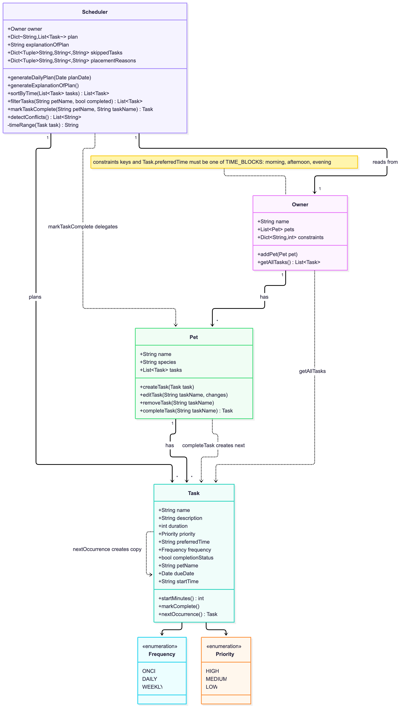

# PawPal+ (Module 2 Project)

You are building **PawPal+**, a Streamlit app that helps a pet owner plan care tasks for their pet.

## Scenario

A busy pet owner needs help staying consistent with pet care. They want an assistant that can:

- Track pet care tasks (walks, feeding, meds, enrichment, grooming, etc.)
- Consider constraints (time available, priority, owner preferences)
- Produce a daily plan and explain why it chose that plan

Your job is to design the system first (UML), then implement the logic in Python, then connect it to the Streamlit UI.

## What you will build

Your final app should:

- Let a user enter basic owner + pet info
- Let a user add/edit tasks (duration + priority at minimum)
- Generate a daily schedule/plan based on constraints and priorities
- Display the plan clearly (and ideally explain the reasoning)
- Include tests for the most important scheduling behaviors

## Getting started

### Setup

```bash
python -m venv .venv
source .venv/bin/activate  # Windows: .venv\Scripts\activate
pip install -r requirements.txt
```

### Suggested workflow

1. Read the scenario carefully and identify requirements and edge cases.
2. Draft a UML diagram (classes, attributes, methods, relationships).
3. Convert UML into Python class stubs (no logic yet).
4. Implement scheduling logic in small increments.
5. Add tests to verify key behaviors.
6. Connect your logic to the Streamlit UI in `app.py`.
7. Refine UML so it matches what you actually built.

## 🛠️ Implementation Summary

The logic layer lives in `pawpal_system.py`; `main.py` is a CLI demo that builds sample data and prints a plan.

**How the classes fit together**

- `Task` is a single care item: name, duration (minutes), `Priority`, a `preferred_time` block, a `Frequency`, and a completion flag. It validates its own input and has `mark_complete()`.
- `Pet` owns a list of tasks. Tasks are added through `Pet.create_task`, which stamps the task with the pet's name and keeps task names unique per pet. It also includes the functionality to edit and remove tasks from a Pet.
- `Owner` owns the pets and the time constraints: the minutes available in each block (`morning`, `afternoon`, `evening`). `Owner.get_all_tasks()` flattens every pet's tasks into one list.
- `Scheduler` takes an `Owner` and produces the plan. It reads from the owner but never changes the owner's data.

**How a plan is built**

1. `generate_daily_plan()` collects the owner's incomplete tasks and sorts them by priority, then by duration.
2. It works from a copy of the owner's constraints. For each task it tries the preferred block first, then the remaining blocks in order, and subtracts the task's duration from the first block with enough time left.
3. A task is skipped, with a recorded reason, if it is longer than every block or if no block has enough time left.
4. Each placement or skip is recorded under a `(pet name, task name)` key in `placement_reasons` or `skipped_tasks`.
5. `generate_explanation_of_plan()` turns those records into the readable text stored in `explanation_of_plan`.

Running `generate_daily_plan()` again rebuilds the plan from scratch, so it is safe to call after editing tasks.

**UML Diagram**

Click the UML Diagram to view on Mermain.ink


[![Live UML Diagram Link](https://mermaid.ink/img/pako:eNqNVntv0zAQ_yqW_-qgq9Z3G6FJ0BaY2OjEhhAoEjLJpY2W2MF2YGVaPztnJ22ctINVauN7n-_xSx9oIEKgHg0SptQ8ZivJUp8T_FgOWf7mIMlDwTKflzdaxnxFOEvB4V7GSm-vQW9JBlo5gnkc6G1h0445ygPBlZYMz64aC0O0buHXODhxJCvQr5Pklqk71TohNo4htoXKo8_ddI3kGdmW3BBUIONMx4I7QsyMhLlkDfa1jIWM9YZk5eHQXyYhAikhvI1r4d5K-JkDDzYk2p0c6Q8hEqxKmiVgQt5opnN1xDnoj_VbzJkGzBTM81BfaSZ1IxHLu4p5rsEUE2_qCFMm72ZFGtByO8DhXi-DIMeb8QBFtspHy7-vkdOCV6-A5ykU9Tw_rwTvL969r6irxfzi81VFXy6_HA1R1fI5MZYfZ4uKmr--uPxakV8Wiw87unkRnMNnj5HKIIhBNbfBTinRZnAdUSAB22VkLTusRu4WG8JYW2np3MhN39skWDO-AuUqS0jFLzim7mqVs3Vc7-lm3gRrCPOksf4FIAjz-8SWV5dHMEgYPywY3Bu-bdYyuq6rWE-3OSa881c8trsnUXdxluGONQr7f0MMGkAKXH8CphCFaiDDzfTgKsXJxmTUsstl0jSHkyOqi-YlajujhNRvNmb9Ws1hOAQxaxHFiQZZ4Fx95dvEhQgIn3Bg9tfw9jvc9PKP1lsHIRoFeiZ4lGAt92hblq9SPNV4rU9mGJ0RLr03JokLrGIkZPke8amD_uQONoowHto8OjXwJGmuNPkBRHD8RuT24mrx_c3lcvbhxiOpkNz0l7AIK8aF4G0Cv8DwfLqLbDbYp12fktPTczy9wJPN1iNrVrbe0kZ8XYP0PfttHa13d6g7NYEcn9XWuIrmVJh7BAEgVPgmEOm_LJx8zZwdeO90zsvQzb7jay2BFU6oqiphtEtvLhqQAo0UMRDvXN5Rr4P_3iAQWa0qjoXzwvY5bdOVjEPqaZlDmyJGp8yQ1GKKT_UaN9KnHh6x9fn9aSASIU0bH9E0Y_ybEOnOWop8taZexBKFVJ6FZmOL_yx7FeAhyJnIuaZed2pdUO-B3lOv3x10JmeDUfdsMu2NxoNhv003qDQcdMajaX887PX6w-m4P3ps0z826hkKRuPucDIZ9M4mo_G09_gXpSvfkg?type=png)](https://mermaid.live/edit#pako:eNqNVv9v2jgU_1cs_0Q3ikr52miqtAG7VWtHtfY03SnS5DkvEDWxc7azK1eVv_2enUCcQLciQfy-P78vn_BEuYyABpSnTOt5wlaKZaEg-HEcsvxXgCJPJct-3t4ZlYgVESwDj3udaLO9BbMlORjtCeYJN9vSppsIlHMptFEMz74aiyK07uDXOjjxJCsw79P0nukH3TkhLo4ltqXKcyj8dK3kFdlW3Ag0V0luEik8IWZGokKxFvtWJVIlZkPy6nDoL1cQg1IQ3SeNcB8V_FOA4BsS706e9IeUKVYly1OwIe8MM4U-4hzMl-Yt5swAZgr2eaivDVOmlYjj3SSiMGCLiTf1hBlTD7MyDej4HRDwaJacF3gzwVHkqny0_PsaeS149w5EkUFZz8vLWvDp6o9PNXWzmF_9eVPT18tvR0PUtXxNjOWX2aKm5u-vrv-qyW-Lxecd3b4IzuGrx0jnwBPQ7W1wU0qMHVxPxBVgu6ys44bVyv1iQ5QYJ62cW7nte5fwNRMr0L6ygkz-hGPqvlY1W8f1Xm7mHV9DVKSt9S8BQdrfF7a8vjyCQcrEYcHg0fJds5bxbVPFebovMOGdv_Kx3T2JfkjyHHesVdjfG2JQDhkI8xWYRhRqgIyw04OrlKQbm1HHLZdN0x5Ojqgu2pdo7IyWynzY2PXrtIfhEMScRZykBlSJc82V7xIfIiB6wYHdX8vb73Dbyy9a7xxEaMTNTIo4xVru0bYqX614avBaX-0weiNceW9NkpBYxViq6j0SUg_9yQNsNGEicnn0GuBJskIb8gOIFPiNyf3VzeL7h-vl7PNdQDKphO0vYTFWTEgpugR-guWFdBfZbnBI-yElp6eXeHqDJ5dtQNasar2jrfi2Ael79scmWu_u0HRqA3k-663xFe2pNA8IAkCk8U0gs19ZePnaOTvw3utdVqHbfcfXWgornFBdV8JqV958NCAlGmliId67vKfeBP-9AZd5oyqehffCDgXt0pVKIhoYVUCXIkZnzJLUYUpIzRo3MqQBHrH1xeMpl6lUto3PaJoz8beUGQ1ilmo0V7JYrfdUkUd2Zcs_LbsImGYEaiYLYWjQHzofNHiijzQY9Ie96dlw3D-bXpyPJ8PRoEs3qDQa9ibji8FkdH4-GF1MBuPnLv3PhT1DwXjSH01H0-n5oD_tXzz_D4UC39c)

## 🖥️ Sample Output

Paste a sample of your app's CLI or Streamlit output here so a reader can see what a generated plan looks like:

```python
(.venv) ➜  codepath/codepath-ai/ai110-module2show-pawpal-starter git:(main) ✗ python3 main.py
Morning (55/60 min used):
  - Rex: prep meal (20 min) - placed in preferred block 'morning' (HIGH priority)
  - Buddy: prep meal (20 min) - placed in preferred block 'morning' (HIGH priority)
  - Buddy: nail trim (15 min) - placed in preferred block 'morning' (MEDIUM priority)
Afternoon (0/0 min used):
  (nothing scheduled)
Evening (60/90 min used):
  - Rex: walk (30 min) - preferred 'morning' was full; moved to 'evening' (HIGH priority)
  - Buddy: walk (30 min) - preferred 'morning' was full; moved to 'evening' (HIGH priority)

Skipped:
  - Rex: bath - 120 min is longer than any available time block (longest is 90 min)
  - Buddy: full groom - 150 min is longer than any available time block (longest is 90 min)
  - Rex: play fetch - no block has 40 min left (remaining: {'morning': 5, 'afternoon': 0, 'evening': 30})
(.venv) ➜  codepath/codepath-ai/ai110-module2show-pawpal-starter git:(main) ✗ 
```

## 🧪 Testing PawPal+

### Run the full test suite:
`python3 -m pytest` or `python -m pytest`

### Run with coverage:
`pytest --cov`


The unit tests cover Sorting Correctness, Recurrence Logic, and Conflict Detection.

### Confidence Level 
4 stars (take a look at the reflection section **4. Testing and Verification**)

Sample test output:
```bash
(.venv) ➜  codepath/codepath-ai/ai110-module2show-pawpal-starter git:(main) python3 -m pytest
========================================================= test session starts =========================================================
platform darwin -- Python 3.14.7, pytest-9.1.1, pluggy-1.6.0
rootdir: /Users/salvadorvillalonjr/Documents/pers/codepath/codepath-ai/ai110-module2show-pawpal-starter
configfile: pytest.ini
testpaths: tests
plugins: anyio-4.15.1
collected 25 items                                                                                                                    

tests/test_pawpal.py .........................                                                                                  [100%]

========================================================= 25 passed in 0.02s ==========================================================
(.venv) ➜  codepath/codepath-ai/ai110-module2show-pawpal-starter git:(main) ✗ 
```

## 📐 Smarter Scheduling

| Feature | Method(s) | Notes |
|---------|-----------|-------|
| Task sorting | `sort_by_time` | Return tasks ordered by _preferred time block_ (morning, afternoon, evening), then _start_time_, then _highest priority_, then _shortest duration_. By default sorts the owner's incomplete tasks. Pass tasks (for example the result of filter_tasks) to sort that list instead, whatever its status. Within a block, tasks with a start_time come first (earliest first), followed by untimed tasks. Ties fall back to priority, then duration. Doesn't modify the plan, any task, or the list passed in. |
| Filtering | `filter_tasks(pet_name, completed)` | Return the owner's tasks matching the given filters. `pet_name`: only tasks belonging to that pet (None = all pets). `completed`: True = only finished tasks, False = only unfinished tasks (None = both). Filters combine, so both can be given at once. |
| Conflict handling | `detect_conflicts` | Return a warning message for every pair of overlapping timed tasks. Only incomplete tasks with a `start_time` are checked, and only tasks due on the same date can conflict. Two tasks overlap when each starts before the other ends (back-to-back tasks don't count). Pairs can belong to the same pet or different pets. Never raises; an empty list means no conflicts. |
| Recurring tasks | `Task.next_occurrence`, `Pet.complete_task`, `Scheduler.mark_task_complete` | `next_occurrence` returns an incomplete copy due on the next occurrence, or `None` for `ONCE` tasks. Daily tasks move forward 1 day and weekly tasks 7 days, counted from the task's `due_date` (not today), so finishing a task late doesn't skip a day. `Pet.complete_task` marks the pet's incomplete task with that name as done and attaches its next occurrence; it returns the new task, or `None` if the task doesn't recur. Completing "walk" twice completes today's walk and then the next day's. `Scheduler.mark_task_complete` finds the pet and delegates to `complete_task`; it raises `KeyError` for an unknown pet or task. |
| Daily planning by date | `generate_daily_plan(plan_date)` | If `plan_date` is given, only incomplete tasks due on or before that date are planned. Overdue tasks are included, and future ones (such as a recurring task's next occurrence) are left out. With no date, every incomplete task is planned. |

## 📸 Demo Walkthrough

### Main UI features

Run the app with `streamlit run app.py`. From top to bottom, the page lets you:

- **Add pets:** enter an owner name, a pet name and a species (dog, cat or other), then click **Add a Pet**. You can add more than one pet, and pet names must be unique.
- **Set your available time:** enter how many minutes you have in the morning, afternoon and evening. The scheduler only fits tasks into this time.
- **Add tasks:** give a task a title, description, duration, priority, preferred time of day and frequency (once, daily or weekly). You can also pick a due date and, optionally, a start time, then assign the task to a pet.
- **Browse tasks:** the task table is sorted by time of day, then start time, priority and duration. Two dropdowns filter it by pet and by status (all, incomplete or completed).
- **See conflict warnings:** if two timed tasks overlap, a warning appears above the task table, naming both tasks and their times.
- **Mark a task complete:** pick a task and click **Mark complete**. If it is a daily or weekly task, a message tells you the next occurrence was created and when it is due.
- **Remove a task:** pick an incomplete task and click **Remove task**, for example to fix a conflict.
- **Build the schedule:** choose a date and click **Generate schedule**. Each time block shows its tasks and how many minutes are used, with the reason each task was placed there. Tasks that did not fit are listed as skipped, with the reason.

### Example workflow

1. Enter an owner name, a pet name ("Mochi") and a species, then click **Add a Pet**.
2. Under **Available time**, set the minutes you have in the morning, afternoon and evening.
3. Add a task, such as "Morning walk" (20 minutes, HIGH priority, preferred time morning, daily) and click **Add task**. Add a second task for the same pet.
4. If you give two tasks the same start time, a conflict warning appears above the task table. Remove one of the tasks to clear the warning.
5. Mark the walk complete. Because it is a daily task, a new walk is created for tomorrow.
6. Under **Build Schedule**, keep the date as today and click **Generate schedule** to see today's plan. Tomorrow's walk is left out because it is not due yet.

### Key scheduler behaviors shown

- **Sorting:** `Scheduler.sort_by_time()` orders tasks by time block, then start time, then priority, then duration.
- **Filtering:** `Scheduler.filter_tasks()` narrows the list by pet, by completion status, or both.
- **Conflict warnings:** `Scheduler.detect_conflicts()` returns warning messages for overlapping tasks instead of raising errors.
- **Recurring tasks:** completing a daily or weekly task creates the next one automatically. One-time tasks do not.
- **Planning:** `Scheduler.generate_daily_plan()` puts high-priority tasks first, moves a task to another block when its preferred block is full, and skips tasks that do not fit, with a reason for each.

### Sample CLI output

Running `python main.py` prints the plan, the sorting and filtering demo, the recurring-task demo and the conflict demo. Dates in the output depend on the day you run it.

```text
Morning (55/60 min used):
  - Rex: prep meal (20 min) - placed in preferred block 'morning' (HIGH priority)
  - Buddy: prep meal (20 min) - placed in preferred block 'morning' (HIGH priority)
  - Buddy: nail trim (15 min) - placed in preferred block 'morning' (MEDIUM priority)
Afternoon (0/0 min used):
  (nothing scheduled)
Evening (60/90 min used):
  - Rex: walk (30 min) - preferred 'morning' was full; moved to 'evening' (HIGH priority)
  - Buddy: walk (30 min) - preferred 'morning' was full; moved to 'evening' (HIGH priority)

Skipped:
  - Rex: bath - 120 min is longer than any available time block (longest is 90 min)
  - Buddy: full groom - 150 min is longer than any available time block (longest is 90 min)
  - Rex: play fetch - no block has 40 min left (remaining: {'morning': 5, 'afternoon': 0, 'evening': 30})

As added (unsorted):
  - [todo] Whiskers: play (evening, 18:00, LOW, 15 min)
  - [todo] Whiskers: litter box (afternoon, no start time, MEDIUM, 10 min)
  - [todo] Whiskers: breakfast (morning, 07:30, HIGH, 5 min)
  - [todo] Whiskers: medicine (evening, 19:00, HIGH, 5 min)
  - [todo] Whiskers: brush fur (morning, 07:00, LOW, 20 min)
  - [done] Whiskers: vet note (afternoon, no start time, LOW, 10 min)
  - [done] Mochi: evening walk (evening, no start time, HIGH, 30 min)
  - [todo] Mochi: breakfast (morning, no start time, HIGH, 5 min)

Sorted by time block, start time, priority, duration (incomplete only):
  - [todo] Whiskers: brush fur (morning, 07:00, LOW, 20 min)
  - [todo] Whiskers: breakfast (morning, 07:30, HIGH, 5 min)
  - [todo] Mochi: breakfast (morning, no start time, HIGH, 5 min)
  - [todo] Whiskers: litter box (afternoon, no start time, MEDIUM, 10 min)
  - [todo] Whiskers: play (evening, 18:00, LOW, 15 min)
  - [todo] Whiskers: medicine (evening, 19:00, HIGH, 5 min)

Filter: incomplete tasks
  - [todo] Whiskers: play (evening, 18:00, LOW, 15 min)
  - [todo] Whiskers: litter box (afternoon, no start time, MEDIUM, 10 min)
  - [todo] Whiskers: breakfast (morning, 07:30, HIGH, 5 min)
  - [todo] Whiskers: medicine (evening, 19:00, HIGH, 5 min)
  - [todo] Whiskers: brush fur (morning, 07:00, LOW, 20 min)
  - [todo] Mochi: breakfast (morning, no start time, HIGH, 5 min)

Filter: completed tasks
  - [done] Whiskers: vet note (afternoon, no start time, LOW, 10 min)
  - [done] Mochi: evening walk (evening, no start time, HIGH, 30 min)

Filter: Whiskers' tasks
  - [todo] Whiskers: play (evening, 18:00, LOW, 15 min)
  - [todo] Whiskers: litter box (afternoon, no start time, MEDIUM, 10 min)
  - [todo] Whiskers: breakfast (morning, 07:30, HIGH, 5 min)
  - [todo] Whiskers: medicine (evening, 19:00, HIGH, 5 min)
  - [todo] Whiskers: brush fur (morning, 07:00, LOW, 20 min)
  - [done] Whiskers: vet note (afternoon, no start time, LOW, 10 min)

Filter: Mochi's incomplete tasks
  - [todo] Mochi: breakfast (morning, no start time, HIGH, 5 min)

Before completing anything:
  - [todo] walk (daily) due 2026-10-18
  - [todo] bath (weekly) due 2026-10-18
  - [todo] vet visit (once) due 2026-10-18

Completed 'walk' -> next one created, due 2026-10-19

Completed 'bath' -> next one created, due 2026-10-25

Completed 'vet visit' -> no next occurrence (one-time task)

After completing all three:
  - [done] walk (daily) due 2026-10-18
  - [done] bath (weekly) due 2026-10-18
  - [done] vet visit (once) due 2026-10-18
  - [todo] walk (daily) due 2026-10-19
  - [todo] bath (weekly) due 2026-10-25

Still to do (incomplete):
  - [todo] walk (daily) due 2026-10-19
  - [todo] bath (weekly) due 2026-10-25

Checking for conflicts:
  Warning: conflict for Luna on 2026-10-18: 'walk' (08:00-08:30) overlaps 'feed' (08:00-08:10)
  Warning: conflict between Luna and Milo on 2026-10-18: 'walk' (08:00-08:30) overlaps 'vet call' (08:15-08:35)

After rescheduling feed to 08:30 and vet call to 09:00:
  No conflicts found.
```

**Screenshot or video** *(optional)*: <!-- Insert a screenshot or link to a demo video here -->
